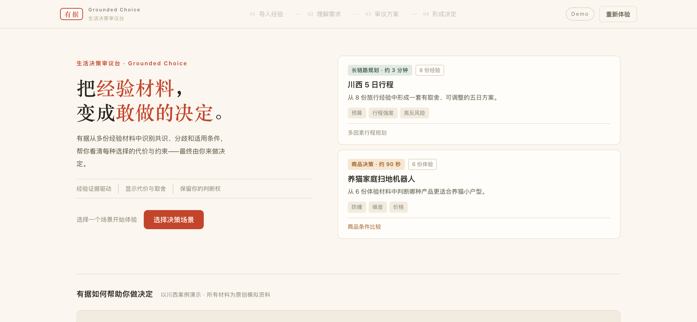

# 有据 Grounded Choice · 生活决策审议台

**[在线体验](https://andyzhang666666.github.io/grounded-choice/)** · [个人网站](https://andyzhang666666.github.io/) · [原始演示](https://redcoworkdev.xiaohongshu.com/s/qlyd4mf4jp/)

> 本项目为受限使用的个人作品集项目，并非开源项目。详细条款见 [LICENSE](./LICENSE)。

**一句话定位**：把一堆经验，变成一个敢做的决定。

有据是一个生活决策审议工具：从一组经验材料中识别**共识与分歧**，生成**带证据状态标注**的三个方案，让人看清收益、代价与反方意见后做出选择，并输出可下载的**决策卡**。它不是搜索引擎，也不是推荐系统——它假设「没有完美选择，只有更适合你的取舍」，推荐（更适合你）与你的选择始终是两个独立状态。



从首页任选川西旅行或养猫家庭扫地机器人，顺着材料、需求、方案和决定走完一轮。页面和资料均为原创模拟演示，不接入真实搜索或电商接口；商品评论也是模拟样本，比价金额由体验者自行填写。

---

## 用户问题

面对一个重要决定——去哪儿旅行、买哪件大件——我们习惯先搜经验、收藏攻略。但收藏夹越满，越难做决定：

- 哪些信息可信，哪些已经过时？
- 谁的处境和我真的相似？
- 观点相反的经验，该怎么权衡？
- AI 给我一个「综合建议」，可它依据的是什么？敢直接照做吗？

有据不帮你「搜得更多」，而是帮你把手头这堆经验变成一个**有证据、有取舍、可以调整**的决定。

## 为什么不是普通 AI 总结

| 普通 AI 总结 | 有据 |
| --- | --- |
| 把分歧磨平成一个平均答案 | 保留分歧，正反双方各自标注材料来源 |
| 生成不可追溯的结论 | 每条结论挂着「材料 ①③」编号，点开看原文片段与作用 |
| 一个不可解释的置信度 | 三档证据状态（证据充分 / 部分充分 / 待验证）+ 可展开的判断依据 |
| 推荐就是答案 | 「更适合你」与「你的选择」是两个状态，反方意见始终在场 |
| 商业内容与真实体验同权 | 可能含商业合作的材料不计入独立证据，并明示标注 |
| 一次生成，无法调整 | 条件变化（预算、天气、同行人数）可预览、可应用、可撤销 |
| 超出预算也无标注地推荐 | 硬约束冲突必须明确标注——不能无标注地将违约方案标为「更适合你」 |

## 两个演示场景

| 场景 | 材料 | 形态 | 大致时长 |
| --- | --- | --- | --- |
| 川西旅行决策 | 8 份旅行经验（原创模拟） | 长链路规划：分析 → 简报 → 审议 → 决定，含五日路线、预算拆分、条件变化模拟 | 约 3 分钟 |
| 养猫家庭扫地机器人选购 | 6 份体验材料（原创模拟） | 商品决策：分析 → 简报 → 对比 → 决定，含购买清单 | 约 90 秒 |

两场景共用同一套分析引擎、证据抽屉与决策卡导出。

## 核心产品流程

1. **选择场景** — 首页两张场景卡，川西在前，可自由进入任一场景
2. **导入经验** — 查看本次决策的全部材料，可取消任意一份；取消后立即影响后续所有结论
3. **理解需求** — 决策简报：**硬约束 / 软偏好 / 使用背景 / 待确认信息**、经验共识与分歧；回答关键问题
4. **审议方案** — 主推荐（更适合你）+ 替代方案 + 横向对比表 + 反方意见；推荐不等于选择
5. **形成决定** — 主动选择方案、模拟条件变化（仅旅行场景）、勾选行动清单、下载决策卡

## 推荐逻辑与硬约束规则

### 约束分类（简报页显示 4 组）

- **硬约束**：不可妥协的门槛条件（旅行：总预算 ≤ 3500 元、行程 5 天、不自驾；扫地机：首年总成本 ≤ 3000 元、2cm 门槛可越过）
- **软偏好**：尽量满足的倾向性需求，允许权衡
- **使用背景**：影响方案匹配的客观背景，非不可妥协的门槛（旅行：女生独自出行 / 首次进高原 / 十一假期；扫地机：两只猫 / 60㎡ 两居室 / 夜间清扫为主）
- **待确认信息**：尚不清楚但会改变方案走向的信息

### 硬约束冲突行为

每个方案对所有硬约束和使用背景条目都有 `meets` 评估（`ok` / `warn` / `no`），引擎动态计算：

- **feasible**（完全满足）：所有 hard 约束均为 `ok`
- **unmetHard**：hard 约束中含 `warn` 或 `no` 的条目列表
- **conflict**：被推荐方案含 `unmetHard` 时触发审议页顶部冲突横幅，提示用户、列出替代方案

预期冲突场景：
- 旅行 `missSpot → B`：方案 B 预算上限 3900 元，超出 3500 元约束 400 元（warn）
- 扫地机 `tangle → A`：方案 A 首年总成本上限 3350 元，超出 3000 元约束 350 元（warn）
- 扫地机 `noise → B`：方案 B 首年总成本下限 3150 元已超 3000 元约束（no）

无冲突场景：旅行 `earlyRise → A`、`budget → C`；扫地机 `price → C`。

用户仍可**主动选择**带冲突的方案，但决定页与决策卡会保留「未满足约束」提示。

### 资料不足行为

- 仅保留 1 份材料（insufficient = 'severe'）→ `exploratory = true`，审议页显示「证据不足 · 探索性方案」徽标，不给确定性推荐（`recommended = null`），决定页与决策卡带「证据不足」注记
- 保留 2 份材料（light）→ 给出「仅供参考」提示，推荐逻辑不变
- 3 份及以上 → 正常流程

贯穿全程的证据诚实原则：

- **三档证据状态**：证据充分（≥3 份相对独立且非商业合作的资料支持，且无强反例）/ 部分充分（2 份支持，或存在强反方经验）/ 待验证（仅 1 份支持或缺少实时信息）
- **「约束满足 X 项」统计由 meets 逐项计算得出，不写死**
- **数据联动**：取消材料后，相关共识（依赖不足 2 份）自动隐藏；分歧任一方材料被取消即隐藏；「多份资料归纳」在有效引用只剩 1 份时降级为「AI 推断」；反方清空后显示「未发现充分反例」

## 产品边界

- 不做全自动决策：关键问题必须由用户回答，方案必须由用户选择
- 不生成虚假百分比、雷达图或精确评分
- 不展示不存在的真实链接，不冒充真实用户内容
- 健康与安全相关内容（如高原反应）仅做信息整理，不替代专业建议
- 行程与价格类内容标注「演示用方案，不构成真实出行建议；班次、天气、价格和开放情况需在出发前核实」
- 决策卡底部固定免责行：「由有据辅助整理，重要信息请在行动前核实」

## 模拟数据边界说明

当前 Demo 的全部材料为**原创模拟内容**（页面内有「演示用模拟资料」标注）：人物、平台署名、产品代号（X1 / X2 / X3 为虚构型号）与数据均为演示用途，不代表任何真实用户、品牌或平台。

材料中唯一的「可能含商业合作」标记（v1）用于演示商业内容降权规则：该材料不计入独立证据计数，不能单独构成「证据充分」。

**购买前辅助模块（扫地机器人场景）**：审议页"评论里怎么说"与决定页"下单前比价"均非实时抓取。评论为演示样本，仅作补充参考，不改变证据状态判定。比价数据由用户手动录入当前到手价，无任何电商平台链接或联网比价功能；X1 / X2 / X3 为虚构型号，不对应任何真实商品。

预算数据已验证（`.tests/test.mjs` 自动校验）：
- 旅行 A: 3200–3500 / B: 3400–3900 / C: 2600–3100（硬约束：≤3500，5 天，不自驾）
- 扫地机 A: 整机 2800–3100（首年 3000–3350）/ B: 2900–3300（首年 3150–3600）/ C: 2200–2600（首年 2350–2850），耗材 150–250 元/年

数据完整性约束（`.tests/test.mjs` 自动校验，现有 254 项检查）：
- 证据引用的原文片段必须是材料摘要的**精确子串**
- 预算拆分各行之和必须等于总额
- meets 评估状态值必须为 `ok` / `warn` / `no`

## 内容数据接口设计（接口层预留）

`js/providers/` 定义了内容检索层接口，当前仅 `mock-provider.js` 参与运行。这是**接口层预留**，不是已接入的功能：

- `content-provider.js`：接口定义与校验器（`createProvider`）
- `mock-provider.js`：唯一数据源，直接读取 `scenarios/` 中的静态数据
- `internal-provider.example.js`：接入真实平台时的示例骨架（方法全部显式抛错，未参与构建，不在主路径）

**自由输入（`importMode: 'custom'`）为开发保留功能，Demo 主路径不暴露。无真实搜索、无外部 API 调用、无网络请求。**

未来接入真实平台的最小改动：按骨架实现同一套接口，在 `mock-provider.js` 装配处替换新 provider，场景、引擎、视图零改动。

## 本地启动方法

任意静态文件服务器均可，无需安装任何依赖：

```bash
python3 -m http.server 3030 --bind 0.0.0.0 --directory .
# 浏览器打开 http://127.0.0.1:3030/
```

纯静态、零依赖、无构建：原生 ES Modules + 原生 CSS，无运行时第三方库、无 CDN、无外部网络请求，可完全离线运行。决策卡 PNG 由浏览器本地 Canvas 绘制（失败自动回退 SVG）。回跑数据校验：`node .tests/test.mjs`。

## 项目结构

```
index.html                    # 单页应用外壳
css/main.css                  # 全部样式（含响应式与降级动画）
js/
  app.js                      # 入口：渲染、事件分发、流程编排
  state.js                    # 应用状态（场景切换重置、逐步守卫）
  analysis-engine.js          # 本地分析引擎（共识/分歧/证据过滤/推荐/约束满足模型）
  card-export.js              # 决策卡导出（Canvas PNG + SVG 回退）
  ui.js                       # 图标、标签、引用芯片、抽屉/弹层/Toast
  scenarios/
    index.js                  # 场景注册表（统一契约，含 constraints 字段）
    travel.js                 # 场景一：川西旅行决策（含 CONSTRAINTS/BRIEF.background/meets）
    robot-vacuum.js           # 场景二：养猫家庭扫地机器人选购（含 CONSTRAINTS/BRIEF.background/meets）
  providers/
    content-provider.js       # 内容检索层接口定义与校验器（接口层预留）
    mock-provider.js          # 演示用模拟数据源（当前唯一数据源）
    internal-provider.example.js  # 接入真实平台的示例骨架（未使用，显式抛错）
  components/
    source-drawer.js          # 来源详情抽屉（引用回跳、多材料切换）
  views/
    home.js                   # 首页（多场景通用、流程五步图、"选择决策场景"按钮）
    import.js / analyze.js    # 导入与分析中间页
    brief.js                  # 决策简报（4 组：硬约束/软偏好/使用背景/待确认）
    deliberation.js           # 审议页（冲突横幅/探索性徽标/feasibleAlternatives）
    decision.js               # 决定页（未满足约束提示/探索性注记/决策卡）
.tests/test.mjs               # 数据完整性与引擎行为自动校验（254 项）
```

## 版权与使用限制

Copyright © 2026 项目作者。保留所有权利。

本项目仅用于作者个人作品展示、学习研究及求职面试评估。未经作者事先书面许可，任何个人或组织不得将本项目的产品概念、交互设计、视觉设计、文字内容、数据结构或源代码用于商业用途，也不得复制、修改、重新发布、转售、部署为公开服务，或用于训练、评估其他产品及模型。

项目中的人物、材料、品牌代号和业务数据均为演示用途的模拟内容，不代表任何真实用户、品牌或平台。

查看本项目不代表获得任何商业使用、再授权或衍生开发许可。如需使用，请先取得作者的明确书面授权。

完整条款见 [LICENSE](./LICENSE)。
